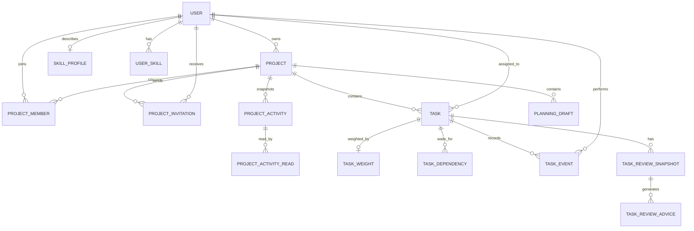

# 数据模型

- `users`：邮箱唯一、姓名、密码哈希、管理员标记、有效状态、头像、创建时间。
- `skill_profiles`：每位用户最多一条画像，记录每周可投入时间、学习目标与更新时间。
- `user_skills`：用户自行填写的技能类别、名称与 1～5 级熟练度；同一类别的技能名称不能重复。
- `projects`：名称、目标、详细需求、技术栈、可选的公开 GitHub 仓库地址、起止日期、负责人、创建时间。
- `project_members`：项目与用户的唯一组合、角色、加入时间。
- `project_invitations`：项目、邀请人与受邀人、状态、发送和处理时间；只有接受后才创建成员记录。
- `project_activities`：项目 ID 与名称快照、操作人、创建或删除动作、时间；不以外键连接项目，因此删除后仍可审计。
- `project_activity_reads`：管理员逐人标记通知已读，不影响其他管理员的未读状态。
- `tasks`：项目、标题、描述、优先级、截止日期、验收条件、预计工时、所需技能、任务执行人、状态、成果说明与链接、代码或 PR 链接、最近一次 GitHub 核验快照、测试记录链接、测试说明、开发清单及时间戳。清单为 JSON 数组，每项包含标题、细节、实现/测试类别和勾选状态；生成清单时重置勾选，任务执行人仅能在进行中更新勾选。代码快照包含类型、标题、作者、状态、SHA 和核验时间，不能当作自动验收结果。
- `task_weights`：每项任务最多一条已确认权重，保存四项指标、规则建议分值、负责人确认分值、计算依据、调整原因和确认人。
- `task_dependencies`：任务与前置任务的链接；两端必须属于同一项目，禁止自依赖和循环依赖。
- `planning_drafts`：保存项目需求快照、AI 原始结构化建议、发起人和草稿状态；负责人确认后批量创建任务。
- `task_events`：任务、操作人、动作、说明、时间；用于追溯状态和验收。
- `task_review_snapshots`：任务、读取人、读取时间和公开 PR 改动快照。快照包含 PR 的 head SHA、标题、作者、状态及受限的文件文本补丁，保存于本地，不代表任务验收通过。
- `task_review_advice`：负责人两次确认并通过安全预检后生成的结构化 AI 建议，关联具体 PR 快照；敏感信息预警时不保存本次 AI 回复。

项目负责人同时在 `project_members` 中有 `owner` 记录。系统管理员是用户的全局权限标记，与项目负责人角色独立。停用用户采用逻辑删除以保留任务和验收记录。现有 SQLite 数据库启动时会补齐新增用户、项目和任务字段，并创建邀请、技能画像、任务权重、依赖、规划草稿、分工草稿和进度报告表。`assignment_drafts` 保存 AI 原始推荐和确认状态；确认后的实际分配及操作人记录在任务和任务事件中。`progress_reports` 保存生成时的规则快照及 AI 建议，不改变任务状态。

数据分析图表不新增持久化表，后端从当前任务、确认权重及仍存在的任务事件实时汇总；删除任务后，对应事件不再计入完成趋势。
